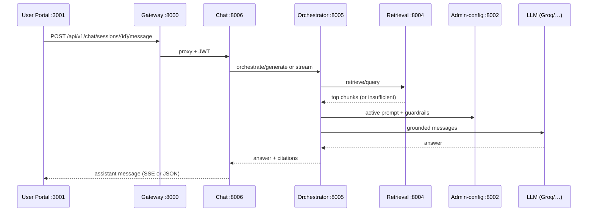
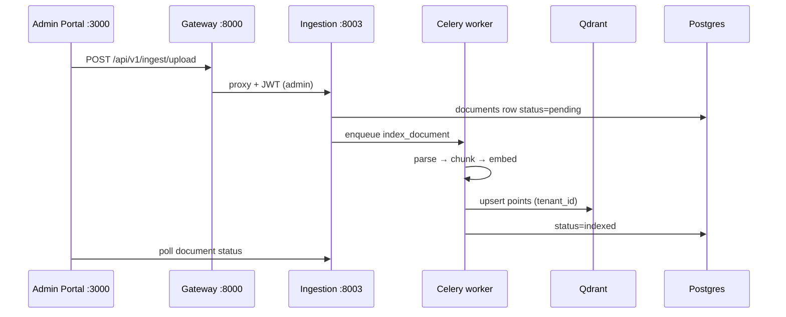

# Architecture — modules & submodules

How `rag-platform` is organized: **two portals**, **seven live microservices** (+ one stub), **shared AI layers**, **shared libraries**, and **infra data stores**. Everything is multi-tenant (`tenant_id` on every data path).

---

## 1. Big picture

```text
┌────────────────────┐     ┌────────────────────┐
│  Admin Portal      │     │  User Portal       │
│  :3000  Next.js    │     │  :3001  Next.js    │
│  Docs / Rules /    │     │  Chat / Compare /  │
│  Users             │     │  History           │
└─────────┬──────────┘     └─────────┬──────────┘
          │  HTTP + JWT              │
          └────────────┬─────────────┘
                       ▼
              ┌────────────────┐
              │  Gateway :8000 │  single public API entry
              └────────┬───────┘
         ┌─────────────┼─────────────┬──────────────┐
         ▼             ▼             ▼              ▼
    Auth :8001   Admin-cfg :8002  Ingest :8003   Chat :8006
                                   │                │
                                   ▼                ▼
                              Celery/Redis    Orchestrator :8005
                                   │                │
                                   ▼                ▼
                              Qdrant :6333    Retrieval :8004
                                   ▲                │
                                   └────────────────┘
                              Postgres :15432   Redis :16379
```

| Layer | What lives here |
|---|---|
| **Presentation** | `frontend/` — Admin + User portals |
| **Edge** | `services/gateway` — route + auth headers |
| **Domain APIs** | auth, admin-config, ingestion, retrieval, orchestrator, chat |
| **AI pipeline** | `ai-core/` packages (imported by services, not HTTP) |
| **Shared code** | `shared-libs/` — schemas, JWT middleware, logging, PII |
| **Data** | Postgres, Qdrant, Redis (Docker) |
| **Ops** | `infra/`, `scripts/`, `docs/` |

---

## 2. Modules (top-level)

| Module | Path | Role |
|---|---|---|
| **Frontend** | `frontend/` | UI for admins and end users |
| **Services** | `services/` | FastAPI microservices |
| **AI Core** | `ai-core/` | Parse → chunk → embed → rerank → LLM router |
| **Shared libs** | `shared-libs/` | Cross-service Python packages |
| **Data** | `data/` | Migrations + vector/collection setup |
| **Infra** | `infra/` | Docker / K8s / CI |
| **Scripts** | `scripts/` | Local start/stop/verify |
| **Samples** | `samples/` | Demo documents for testing |
| **Docs** | `docs/` | Specs + this architecture |
| **Evals** | `evals/` | Offline RAG quality checks |

---

## 3. Frontend submodules

```
frontend/
├── admin-portal/     # :3000 — Documents, Rules, Guardrails, Users
├── user-portal/      # :3001 — Chat, Compare, History
└── shared-ui/        # Shared design system / components (@rag-platform)
```

| Submodule | Audience | Main jobs |
|---|---|---|
| **admin-portal** | Tenant admins | Upload/index docs, edit prompts & guardrails, manage users |
| **user-portal** | End users | Ask KB questions, tender compare, session history |
| **shared-ui** | Both apps | Reusable UI so portals stay visually consistent |

Both talk to the **gateway** (`http://localhost:8000`) with a JWT after login.

---

## 4. Backend services (submodules)

Each live service (except gateway) follows **Clean Architecture** under `app/`:

```
app/
├── api/             # HTTP routes (FastAPI routers)
├── application/     # Use-cases / business orchestration
├── domain/          # Models / entities (where present)
└── infrastructure/  # DB, Qdrant, HTTP clients, Celery
```

| Service | Port | Submodule path | Responsibility |
|---|---|---|---|
| **Gateway** | 8000 | `services/gateway` | Single entry; proxies `/api/v1/*` to backends; JWT check |
| **Auth** | 8001 | `services/auth-service` | Tenants, register/login, JWT issue |
| **Admin config** | 8002 | `services/admin-config-service` | Versioned system prompts + guardrail policies |
| **Ingestion** | 8003 | `services/ingestion-service` | Upload files → async index pipeline |
| **Retrieval** | 8004 | `services/retrieval-service` | Hybrid search + rerank (tenant-scoped) |
| **LLM orchestrator** | 8005 | `services/llm-orchestrator-service` | Retrieve context → build prompt → call LLM → guardrails |
| **Chat** | 8006 | `services/chat-service` | Sessions, messages, SSE streaming; calls orchestrator |
| **Notification** | 8007 | `services/notification-service` | *Stub* — ingestion status push (not fully wired) |

Gateway route map (conceptual):

| Client path | Backend |
|---|---|
| `/api/v1/auth/*` | auth-service |
| `/api/v1/admin/*`, `/api/v1/config/*` | admin-config-service |
| `/api/v1/ingest/*` | ingestion-service |
| `/api/v1/retrieve/*` | retrieval-service |
| `/api/v1/orchestrate/*` | llm-orchestrator-service |
| `/api/v1/chat/*` | chat-service |

---

## 5. AI Core submodules (pipeline layers)

These are **libraries**, not HTTP services. Ingestion / retrieval / orchestrator import them.

```
ai-core/
├── parsing/      # Layer 1 — PDF/DOCX/MD/images → text (+ tables/OCR)
├── chunking/     # Layer 2 — text → overlapping chunks
├── embedding/    # Layer 3 — chunks → 1024-d vectors (BGE or fake)
├── reranking/    # Layer 5 — score query↔passage (BGE reranker or fake)
└── llm_router/   # Layer 7 — Groq → Gemini → OpenRouter → Ollama
```

| Layer | Package | Used by |
|---|---|---|
| 1 Parse | `rag_platform_parsing` | ingestion worker |
| 2 Chunk | `rag_platform_chunking` | ingestion worker |
| 3 Embed | `rag_platform_embedding` | ingestion + retrieval |
| 5 Rerank | `rag_platform_reranking` | retrieval |
| 7 LLM | `rag_platform_llm_router` | orchestrator |

Local demo often sets `EMBEDDING_MODEL_NAME=fake` and `RERANKER_MODEL_NAME=fake` for speed; chat still uses real Groq when `LLM_ROUTER_MODE=litellm`.

---

## 6. Shared libraries

```
shared-libs/
├── schemas/            # Pydantic models (auth, chat, retrieval, …)
├── auth-middleware/    # JWT validation + tenant injection
├── observability/      # Structured logs, metrics, tracing
└── pii/                # Scrub PII before cloud LLM calls
```

Every service depends on **schemas** + **auth-middleware** + **observability**. Orchestrator also uses **pii**.

---

## 7. Data & infra submodules

```
data/
├── postgres/     # Alembic migrations (tenants, users, docs, chat, …)
├── qdrant/       # Collection setup (document_chunks, 1024-d)
└── redis/        # Broker/cache notes

infra/
├── docker/           # Per-service Dockerfiles
├── docker-compose/   # Compose overlays
├── k8s/              # Kubernetes base + staging/prod overlays
├── terraform/        # Cloud IaC (where used)
└── ci-cd/            # Pipeline templates
```

| Store | Host port (local override) | Holds |
|---|---|---|
| **Postgres** | 15432 | Tenants, users, documents metadata, chat history, prompts |
| **Qdrant** | 6333 | Chunk vectors + payload (`tenant_id`, `doc_id`, text, …) |
| **Redis** | 16379 | Celery broker / results (ingestion jobs) |

---

## 8. Request flows

### A) Chat (user asks a question)



### B) Document upload (admin indexes knowledge)



---

## 9. Multi-tenancy (cross-cutting)

- **Postgres:** every business table has `tenant_id` (RLS / app filters).
- **Qdrant:** every point payload includes `tenant_id`; retrieval always filters on it.
- **JWT:** carries `tenant_id` + `role` (`admin` | `end_user`); services enforce both.
- New domain = new tenant row + users + docs — **no new microservice**.

---

## 10. Spec modules (product docs)

Detailed written specs (requirements → roadmap):

| Doc | Topic |
|---|---|
| [`docs/modules/01-…`](modules/01-requirements-and-project-structure.md) | Requirements & folder principles |
| [`docs/modules/02-…`](modules/02-frontend-module.md) | Frontend |
| [`docs/modules/03-…`](modules/03-backend-microservices-module.md) | Backend services |
| [`docs/modules/04-…`](modules/04-ai-pipeline-module.md) | AI pipeline |
| [`docs/modules/05-…`](modules/05-data-and-multitenancy-module.md) | Data & tenancy |
| [`docs/modules/06-…`](modules/06-infra-and-devops-module.md) | Infra / DevOps |
| [`docs/modules/07-…`](modules/07-security-and-guardrails-module.md) | Security |
| [`docs/modules/08-…`](modules/08-testing-and-evaluation-module.md) | Testing / evals |
| [`docs/modules/09-…`](modules/09-implementation-roadmap-module.md) | Build stages |

Run instructions stay in the root [`README.md`](../README.md). API keys: [`API_KEYS.md`](API_KEYS.md).
